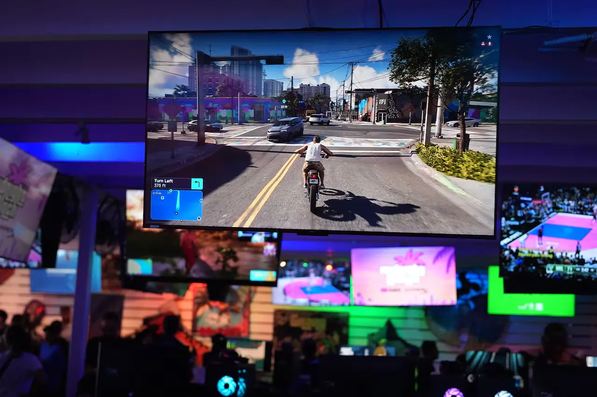

# GTA 6 Port Tracker — GTA 6 PC Port News, Leaks & Updates

### Is GTA 6 Playable on PC Yet?

**Track GTA 6 PC port developments, Leonida Project updates, community porting efforts, alleged leaks, and official Rockstar Games announcements — all in one place.**

 

  

### 🎮 [TRACK THE LATEST GTA 6 PORT UPDATES →](https://gta6port.app/)

https://gta-6-port.github.io/gta6port/

**Latest News · Community Projects · Verified Sources · GTA 6 PC Port Timeline**

---

## 🎮 What Is GTA 6 Port Tracker?

**[GTA6Port.app](https://gta6port.app/)** is an independent GTA 6 port tracking website dedicated to following the development, rumors, and community efforts surrounding **Grand Theft Auto VI on PC**.

The website brings together official Rockstar Games announcements, GTA 6 PC port discussions, community development projects, and alleged game leaks into a continuously updated timeline.

Instead of relying on scattered social media posts, users can explore GTA 6 port developments with links to original sources and clearly identified verification statuses.

### What We Track

- **GTA 6 PC Port News** — Developments related to bringing Grand Theft Auto VI to PC.
- **GTA 6 Port Timeline** — A chronological record of important announcements, rumors, and community developments.
- **Leonida GTA 6 Port Project** — Community efforts exploring GTA 6 compatibility and porting technologies.
- **GTA 6 Leaks** — Alleged game files, screenshots, videos, and related claims.
- **Community Projects** — Public repositories, research, and technical experiments.
- **Official Rockstar Announcements** — Confirmed information about GTA VI platforms and release plans.
- **Source Verification** — Clear distinctions between confirmed information, project claims, and unverified reports.

> **Visit the live tracker: [https://gta6port.app/](https://gta6port.app/)**

---

## 🖥️ GTA 6 PC Port — Latest Status

One of the biggest questions surrounding Grand Theft Auto VI is:

**When will GTA 6 be available on PC?**

GTA 6 Port Tracker follows official announcements and community developments to help players understand the current situation.

| Topic | What We Track |
|---|---|
| GTA 6 PC Release Date | Official Rockstar announcements and platform availability |
| GTA 6 PC Port | Reports and developments concerning PC compatibility |
| Leonida Project | Community porting research and technical progress |
| GTA 6 Leaks | Alleged game files, screenshots, and related claims |
| GTA 6 Community Projects | Public repositories and independent development efforts |
| GTA 6 Port Timeline | Important events and their original sources |

### 🔴 Is GTA 6 Playable on PC?

The existence of an unofficial porting project, alleged game files, or a technical demonstration does not establish that GTA 6 is playable on PC.

For current official platform availability and independently verified community developments, visit:

### 👉 [CHECK GTA 6 PC PORT STATUS →](https://gta6port.app/)

---

## 📅 GTA 6 Port Timeline — News, Leaks & Developments

The **GTA 6 Port Timeline** is one of the core features of GTA6Port.app.

It organizes important developments related to GTA 6 PC availability, community projects, and alleged leaks into a chronological record.

### Events Covered

- Official GTA VI announcements from Rockstar Games.
- GTA 6 PC release discussions and platform updates.
- Community attempts to investigate GTA 6 porting.
- Leonida Project announcements and repository developments.
- Alleged GTA 6 game file leaks and download claims.
- Community research into game compatibility and technical limitations.

Whenever available, timeline entries include the original source and a verification label.

### Why Verification Matters

Not every GTA 6 port claim is reliable.

Online discussions may contain misleading screenshots, fabricated download links, edited videos, or unverified technical demonstrations.

GTA6Port.app distinguishes between:

| Verification Status | Meaning |
|---|---|
| Official | Information published by Rockstar Games or another relevant official source |
| Verified | Information supported by independently verifiable evidence |
| Community Report | Claims or updates published by independent developers or researchers |
| Unverified | Information that lacks sufficient independent confirmation |
| Disputed | Claims contradicted by available evidence or challenged by credible sources |

**📅 [EXPLORE THE GTA 6 PORT TIMELINE →](https://gta6port.app/)**

---

## 🛠️ Leonida Project — GTA 6 Community Port Research

The **Leonida Project** is one of the community initiatives followed by GTA 6 Port Tracker.

Interest in Leonida has grown alongside discussions about unofficial GTA 6 PC porting efforts.

The project is associated with technical research into compatibility, asset processing, and game runtime technologies.

### Technical Areas of Interest

Community porting research may involve:

- **Static Recompilation** — Investigating approaches for translating compiled game code between architectures.
- **Shader Translation** — Exploring compatibility between different graphics APIs and shader formats.
- **Asset Processing** — Research into game textures, audio, and other asset formats.
- **Runtime Compatibility** — Investigating the software environment needed to execute game code.
- **Rendering Research** — Exploring graphics translation and rendering compatibility.
- **Game Boot Research** — Identifying technical barriers that prevent a game from starting.

### Is the Leonida GTA 6 Port Playable?

A public repository, technical demonstration, or reported progress does not necessarily mean that a playable GTA 6 PC port exists.

Claims about game compatibility, successful execution, and technical milestones require independent verification.

GTA6Port.app follows publicly available information about Leonida and related community projects without presenting unverified claims as established facts.

**🔎 [FOLLOW LEONIDA GTA 6 PORT UPDATES →](https://gta6port.app/)**

---

## 🔍 GTA 6 Leaks, Cyberleek & Community Investigations

GTA 6 has attracted significant attention from gaming communities, researchers, and social media users.

GTA 6 Port Tracker documents notable claims involving alleged game files, screenshots, technical demonstrations, and unofficial distribution rumors.

### Topics We Follow

#### GTA 6 Game File Leaks

Reports involving alleged GTA VI game archives, file sizes, and downloadable builds.

#### Cyberleek GTA 6 Claims

Publicly reported claims and community discussions associated with Cyberleek.

#### GTA 6 PC Gameplay Claims

Videos or screenshots that allegedly show GTA VI running on PC.

#### Community Verification

Research and discussions examining whether alleged leaks or technical demonstrations are authentic.

### Important Notice

GTA6Port.app is an informational tracking project.

We do not host, distribute, or provide unauthorized copies of Grand Theft Auto VI, leaked game builds, copyrighted game assets, or pirated software.

References to alleged leaks are provided for news reporting, research, and historical documentation.

**📰 [EXPLORE GTA 6 LEAK REPORTS & UPDATES →](https://gta6port.app/)**

---

## 🌴 Grand Theft Auto VI — Vice City & Leonida

Grand Theft Auto VI takes players to the fictional state of **Leonida**, including a modern interpretation of **Vice City**.

The game's setting, characters, and technical ambitions have generated substantial interest in its eventual PC availability.

For PC players, important questions include:

- Will GTA 6 receive an official PC release?
- When will Rockstar announce GTA 6 for PC?
- What are the differences between official and unofficial GTA 6 ports?
- Can community projects make GTA 6 playable on PC?
- Are reported GTA 6 PC gameplay videos authentic?
- What is the actual progress of the Leonida Project?

GTA6Port.app tracks developments relevant to these questions and updates its coverage as new information becomes available.

---

## ⭐ Why Use GTA6Port.app?

### 1. GTA 6 Port Updates in One Place

Follow important GTA 6 PC port developments without searching through multiple forums, repositories, and social media platforms.

### 2. Chronological Event Tracking

Explore a structured timeline showing when announcements, rumors, and community developments occurred.

### 3. Original Sources

Find references to official announcements, public repositories, and community discussions whenever available.

### 4. Community Project Coverage

Follow Leonida and other GTA 6-related technical initiatives through their publicly reported developments.

### 5. Clear Verification Status

Understand the difference between official information, independently verified evidence, and unconfirmed claims.

### 6. Independent Coverage

GTA6Port.app is an independent fan-made information resource, not an official Rockstar Games website.

---

## ❓ Frequently Asked Questions

### What is GTA 6 Port?

A GTA 6 port generally refers to adapting Grand Theft Auto VI to run on a platform other than the one for which a particular version was developed.

In online discussions, **GTA 6 Port** often refers to the possibility of playing GTA VI on PC, either through an official Rockstar release or an unofficial community effort.

### Is GTA 6 available on PC?

Check the latest official Rockstar Games announcements and the current platform status on [GTA6Port.app](https://gta6port.app/).

Unofficial community projects should not be confused with an official PC release.

### When is the GTA 6 PC release date?

An official GTA 6 PC release date must come from Rockstar Games or Take-Two Interactive.

Rumored dates should not be treated as confirmed announcements.

Follow [GTA 6 PC Release Updates](https://gta6port.app/) for the latest tracked information.

### What is the Leonida GTA 6 Port Project?

Leonida is a community project associated with GTA 6 porting research and technical experimentation.

Its reported developments should be evaluated using public source material and independently verifiable evidence.

### Can I download GTA 6 for PC?

Be cautious of websites claiming to offer unofficial GTA 6 PC downloads.

Such downloads may be unauthorized, misleading, or unsafe.

Use official Rockstar Games channels for legitimate release information.

### Are GTA 6 leaks real?

Some GTA 6-related material has been publicly authenticated, while many online claims remain unverified.

Each new claim should be assessed individually using reliable sources.

### Is GTA6Port.app affiliated with Rockstar Games?

No.

GTA6Port.app is an independent fan-made tracking website and is not affiliated with, endorsed by, or sponsored by Rockstar Games or Take-Two Interactive.

---

## 🔗 Official Sources & Useful Links

For reliable GTA VI information, consult official announcements and original public sources.

| Resource | Link |
|---|---|
| GTA 6 Port Tracker | https://gta6port.app/ |
| Rockstar Games | https://www.rockstargames.com/ |
| Grand Theft Auto VI | https://www.rockstargames.com/VI |
| Rockstar Games Newswire | https://www.rockstargames.com/newswire |
| Take-Two Interactive | https://www.take2games.com/ |

For community projects and alleged leaks, GTA6Port.app provides source references within the relevant coverage whenever available.

---

## 🌐 Visit GTA 6 Port Tracker

### Stay Updated on GTA 6 PC Port Developments

**Official News · Community Projects · Leonida Updates · Alleged Leaks · Original Sources**

 

### 🎮 [EXPLORE GTA 6 PORT TRACKER →](https://gta6port.app/)

 

 

**https://gta6port.app/**

---

## ⚖️ Disclaimer

GTA6Port.app is an independent, fan-made informational project.

Grand Theft Auto, Grand Theft Auto VI, GTA, Rockstar Games, and related names, trademarks, characters, artwork, and intellectual property belong to their respective owners.

This project is not affiliated with, endorsed by, or sponsored by Rockstar Games, Rockstar North, or Take-Two Interactive.

The website documents publicly available information for news reporting, research, and community reference.

Information about unofficial ports, alleged leaks, and community projects may be incomplete, inaccurate, or subject to change.

---

### GTA 6 Port Tracker

**Follow the Road to GTA VI on PC**

[🌐 Website](https://gta6port.app/) · [🎮 Rockstar Games](https://www.rockstargames.com/) · [🌴 GTA VI Official Page](https://www.rockstargames.com/VI)

